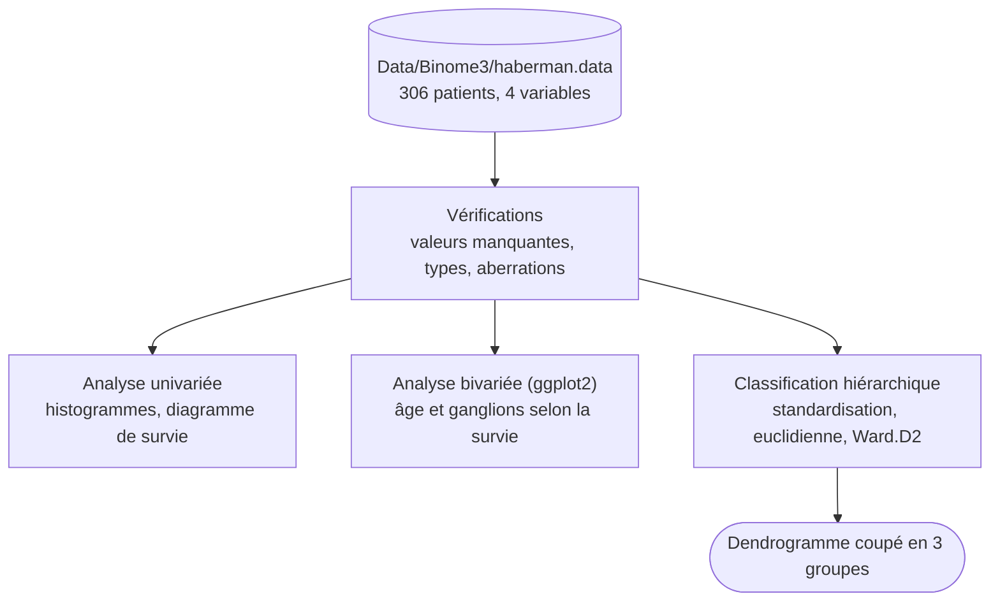

<p align="right"><a href="./README.md">English</a> | <b>Français</b></p>

<h1 align="center">Survival Data Analysis</h1>

<p align="center">
  <a href="https://www.r-project.org"></a>
  <a href="https://ggplot2.tidyverse.org"></a>
  <a href="http://factominer.free.fr"></a>
  <a href="LICENSE"></a>
</p>

> **Analyse statistique en R de la survie à cinq ans après une chirurgie du cancer du sein, sur les 306 patientes du jeu de données Haberman's Survival.**

Quelles caractéristiques des patients vont de pair avec une survie d'au moins cinq ans après l'opération ? Le projet vérifie les données, étudie chaque variable seule puis face au statut de survie, et regroupe les patients par classification hiérarchique. Le signal le plus net vient du nombre de ganglions axillaires positifs : 14 % des patients sans ganglion atteint sont décédés dans les cinq ans, contre 58 % de ceux qui en avaient entre 11 et 20.

<p align="center">
  <a href="#résultats">Résultats</a> ·
  <a href="#fonctionnement">Fonctionnement</a> ·
  <a href="#données">Données</a> ·
  <a href="#démarrage-rapide">Démarrage rapide</a> ·
  <a href="#structure-du-projet">Structure du projet</a>
</p>

<p align="center">
  
</p>

---

## Résultats

Sur les 306 patients, 225 (73,5 %) ont survécu cinq ans ou plus et 81 sont décédés avant cinq ans. Taux de décès à cinq ans selon le nombre de ganglions axillaires positifs :

| Ganglions positifs | Patients | Décès avant 5 ans |
|---|---|---|
| 0 | 136 | 14,0 % |
| 1 | 41 | 19,5 % |
| 2 à 5 | 59 | 32,2 % |
| 6 à 10 | 30 | 40,0 % |
| 11 à 20 | 26 | 57,7 % |
| 21 à 50 | 13 | 53,8 % |
| plus de 50 | 1 | 100 % |

- Le risque augmente régulièrement avec le nombre de ganglions ; à partir d'environ 10 ganglions, à peu près un patient sur deux décède dans les cinq ans.
- L'âge ne joue qu'aux extrêmes : les 7 patients de moins de 34 ans ont tous survécu et les deux plus âgés (78 et 83 ans) non, mais la corrélation entre l'âge et le statut de survie est quasi nulle (r = 0,07).
- Le nombre de ganglions est la seule variable nettement corrélée au statut de survie (r = 0,29). L'année de l'opération n'en montre aucune.

Le [rapport](Rapport.pdf) va plus loin, avec une matrice de corrélation, une analyse en composantes principales (les deux premiers axes expliquent 70,2 % de la variance) et un clustering k-means. Le code de ces étapes figure uniquement dans le rapport ; [`Code/Code.R`](Code/Code.R) couvre les étapes du schéma ci-dessous.

---

## Fonctionnement



Tout tient dans un seul script, [`Code/Code.R`](Code/Code.R) :

1. Il charge le fichier brut, nomme les quatre colonnes et vérifie les valeurs manquantes (aucune), les types et les valeurs aberrantes avec `summary()`.
2. Il trace la distribution de l'âge, du nombre de ganglions et du statut de survie, puis la survie selon l'âge (tranches de 5 ans) et selon le groupe de ganglions.
3. Il standardise l'âge, l'année et le nombre de ganglions (sans le statut de survie), calcule une matrice de distances euclidiennes et applique la classification hiérarchique de Ward, coupée en trois groupes.

<p align="center">
  
</p>

---

## Données

Le jeu de données [Haberman's Survival](https://archive.ics.uci.edu/dataset/43/haberman+s+survival) de l'UCI Machine Learning Repository, inclus dans `Data/Binome3/`. Il porte sur des patients opérés d'un cancer du sein entre 1958 et 1970 à l'hôpital Billings de l'Université de Chicago, sans aucune valeur manquante.

| Variable | Description |
|---|---|
| Age | âge du patient au moment de l'opération (30 à 83 ans) |
| Year | année de l'opération moins 1900 (58 à 69) |
| Nodes | nombre de ganglions axillaires positifs détectés (0 à 52) |
| Status | 1 = survie de 5 ans ou plus, 2 = décès avant 5 ans |

Source : Haberman, S. J. (1976). Generalized Residuals for Log-Linear Models. Proceedings of the 9th International Biometrics Conference, Boston, pp. 104-122.

---

## Démarrage rapide

Il vous faut [R](https://cran.r-project.org). Installez les packages chargés par le script :

```r
install.packages(c("ggplot2", "FactoMineR", "cluster", "MASS"))
```

Lancez ensuite le script depuis la racine du dépôt, car le chemin des données est relatif :

```bash
git clone https://github.com/Yvngval/Survival-data-analysis.git
cd Survival-data-analysis
Rscript Code/Code.R
```

Hors de RStudio, `Rscript` enregistre les graphiques dans `Rplots.pdf`. Dans RStudio, prenez le dossier du projet comme répertoire de travail et exécutez `source("Code/Code.R")`.

---

## Structure du projet

```text
Code/Code.R                  script d'analyse
Data/Binome3/haberman.data   données brutes (306 lignes)
Data/Binome3/haberman.names  description du jeu de données
Rapport.pdf                  rapport final
PROJET_TND_*.pdf             consignes du projet
docs/assets/                 figures utilisées dans ce README
```

---

## Contribuer

Les issues et pull requests sont les bienvenues. Consultez [CONTRIBUTING.md](CONTRIBUTING.md).

## Licence

Le code est publié sous [licence MIT](LICENSE). Le jeu de données provient de l'UCI Machine Learning Repository.

## Auteurs

<a href="https://github.com/thmsgo18"></a>
<a href="https://github.com/Yvngval"></a>

Thomas Gourmelen ([@thmsgo18](https://github.com/thmsgo18)), Nadil Hamdan et Valentin Ponnoussamy ([@Yvngval](https://github.com/Yvngval)), groupe 3 du cours de Traitement numérique de données, Université Paris Cité, 2024-2025. Encadrement : Nicoleta Rogovschi.
