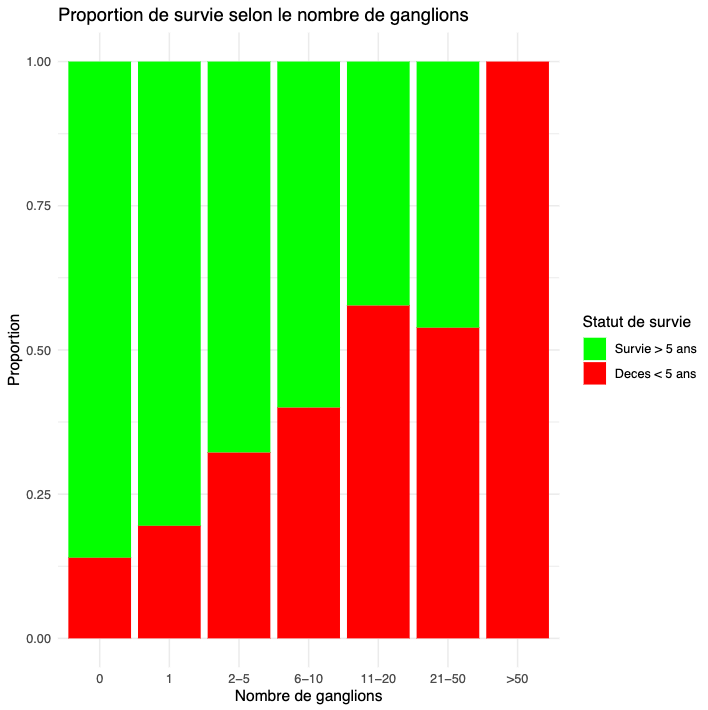
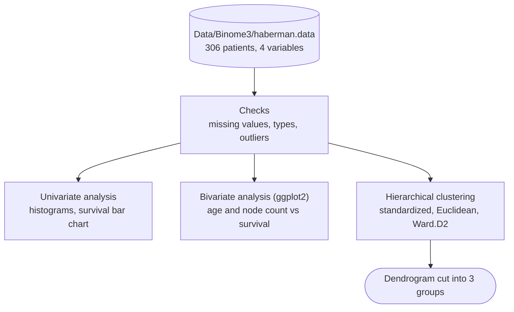
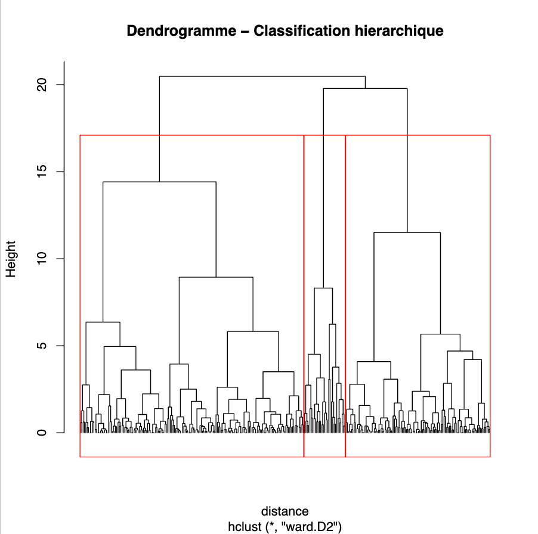

<p align="right"><b>English</b> | <a href="./README.fr.md">Français</a></p>

<h1 align="center">Survival Data Analysis</h1>

<p align="center">
  <a href="https://www.r-project.org"></a>
  <a href="https://ggplot2.tidyverse.org"></a>
  <a href="http://factominer.free.fr"></a>
  <a href="LICENSE"></a>
</p>

> **Statistical analysis in R of five-year survival after breast cancer surgery, on the 306 patients of Haberman's Survival dataset.**

Which patient characteristics go with surviving at least five years after the operation? The project checks the data, studies each variable alone and against survival status, then groups patients with hierarchical clustering. The clearest signal is the number of positive axillary lymph nodes: 14% of patients with none died within five years, against 58% of those with 11 to 20.

<p align="center">
  <a href="#results">Results</a> ·
  <a href="#how-it-works">How it works</a> ·
  <a href="#data">Data</a> ·
  <a href="#getting-started">Getting started</a> ·
  <a href="#project-structure">Project structure</a>
</p>

<p align="center">
  
</p>

---

## Results

Of the 306 patients, 225 (73.5%) survived five years or longer and 81 died within five years. Death rate within five years by number of positive axillary nodes:

| Positive nodes | Patients | Died within 5 years |
|---|---|---|
| 0 | 136 | 14.0% |
| 1 | 41 | 19.5% |
| 2 to 5 | 59 | 32.2% |
| 6 to 10 | 30 | 40.0% |
| 11 to 20 | 26 | 57.7% |
| 21 to 50 | 13 | 53.8% |
| more than 50 | 1 | 100% |

- The risk rises steadily with the node count; from about 10 nodes, roughly one patient in two died within five years.
- Age matters at the extremes only: the 7 patients under 34 all survived and the two oldest (78 and 83) did not, but the correlation between age and survival status is close to zero (r = 0.07).
- The node count is the only variable with a noticeable correlation with survival status (r = 0.29). The year of operation shows none.

The [report](Rapport.pdf) (in French) goes further, with a correlation matrix, a principal component analysis (the first two axes explain 70.2% of the variance) and k-means clustering. The code for those steps appears in the report only; [`Code/Code.R`](Code/Code.R) covers the steps in the diagram below.

---

## How it works



Everything runs from one script, [`Code/Code.R`](Code/Code.R):

1. It loads the raw file, names the four columns and checks for missing values (none), types and outliers with `summary()`.
2. It plots the distribution of age, node count and survival status, then survival by age (5-year bins) and by node-count group.
3. It standardizes age, year and node count (survival status left out), builds a Euclidean distance matrix and runs Ward's hierarchical clustering, cut into three groups.

<p align="center">
  
</p>

---

## Data

[Haberman's Survival dataset](https://archive.ics.uci.edu/dataset/43/haberman+s+survival) from the UCI Machine Learning Repository, included in `Data/Binome3/`. It covers patients operated on for breast cancer between 1958 and 1970 at the University of Chicago's Billings Hospital, with no missing values.

| Variable | Description |
|---|---|
| Age | age of the patient at the time of operation (30 to 83) |
| Year | year of operation minus 1900 (58 to 69) |
| Nodes | number of positive axillary nodes detected (0 to 52) |
| Status | 1 = survived 5 years or longer, 2 = died within 5 years |

Source: Haberman, S. J. (1976). Generalized Residuals for Log-Linear Models. Proceedings of the 9th International Biometrics Conference, Boston, pp. 104-122.

---

## Getting started

You need [R](https://cran.r-project.org). Install the packages the script loads:

```r
install.packages(c("ggplot2", "FactoMineR", "cluster", "MASS"))
```

Then run the script from the root of the repository, since the data path is relative:

```bash
git clone https://github.com/Yvngval/Survival-data-analysis.git
cd Survival-data-analysis
Rscript Code/Code.R
```

Outside RStudio, `Rscript` writes the plots to `Rplots.pdf`. In RStudio, open the project folder as the working directory and run `source("Code/Code.R")`.

---

## Project structure

```text
Code/Code.R                  analysis script
Data/Binome3/haberman.data   raw data (306 rows)
Data/Binome3/haberman.names  dataset description
Rapport.pdf                  final report, in French
PROJET_TND_*.pdf             project instructions, in French
docs/assets/                 figures used in this README
```

---

## Contributing

Issues and pull requests are welcome. See [CONTRIBUTING.md](CONTRIBUTING.md).

## License

The code is released under the [MIT License](LICENSE). The dataset comes from the UCI Machine Learning Repository.

## Authors

<a href="https://github.com/thmsgo18"></a>
<a href="https://github.com/Yvngval"></a>

Thomas Gourmelen ([@thmsgo18](https://github.com/thmsgo18)), Nadil Hamdan and Valentin Ponnoussamy ([@Yvngval](https://github.com/Yvngval)), group 3 of the Traitement numérique de données course (digital data processing), Université Paris Cité, 2024-2025. Supervised by Nicoleta Rogovschi.
